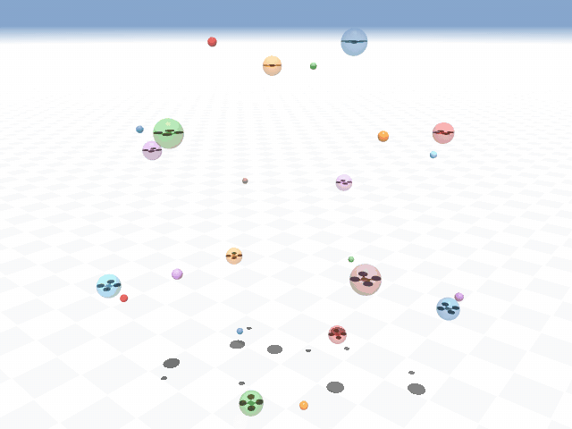
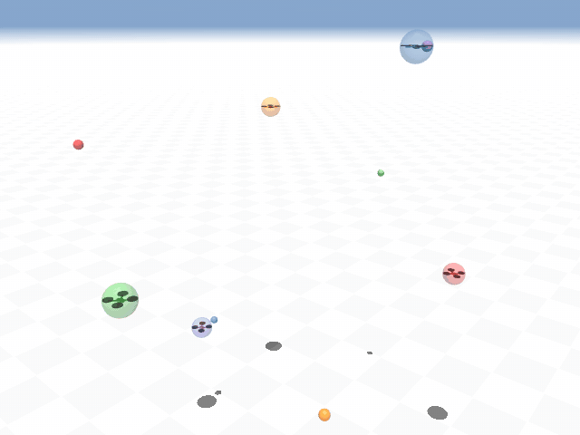
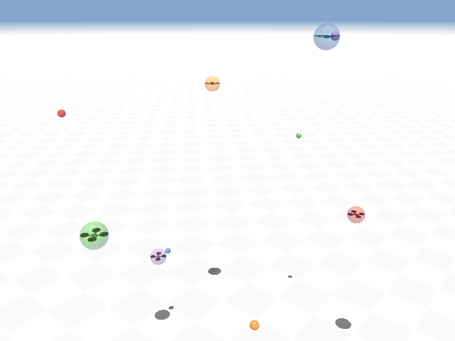
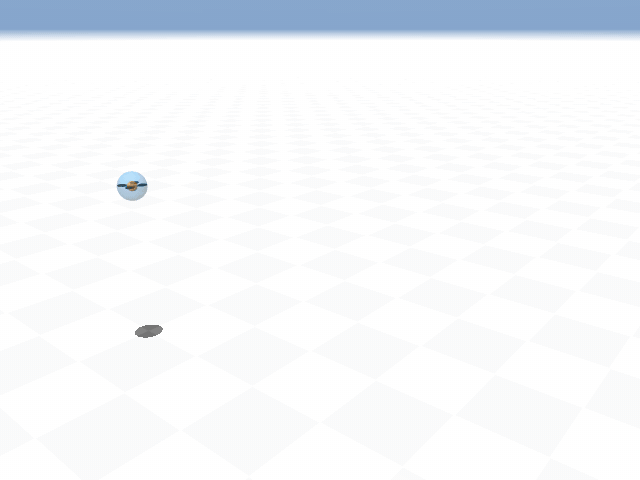
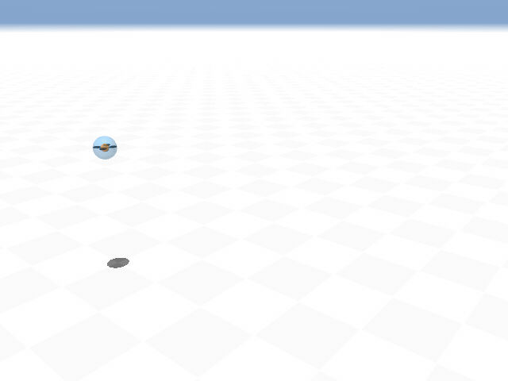

# Multi-Robot Atlas

A deterministic 3D simulator and (eventually) benchmark for multi-drone
navigation in shared airspace, built on [MuJoCo](https://mujoco.org).

<p align="center">
  
</p>
<p align="center">
  <em>Twelve drones swap sides of a sphere, so every straight path crosses at
  one point. Distributed MPC with the safety filter gets all twelve through
  with no contact. The translucent bubbles are the collision spheres; the
  small dots are the goals.</em>
</p>

**Status: milestone M2.** The simulator, a quadrotor autopilot, a distributed
MPC planner and a runtime safety filter are in place, alongside a naive
straight-line baseline that shows what happens without them.

## What is here

- **Quadrotor dynamics in MuJoCo.** Each drone is a free rigid body driven by
  collective thrust and three body torques.
- **Geometric SE(3) autopilot** (500 Hz) that tracks velocity setpoints.
- **Policy interface** (50 Hz): world state in, one velocity setpoint per
  drone out.
- **`DMPCPolicy`**: distributed model predictive control. Each drone solves
  its own small QP (OSQP) every 0.1 s over a 1.5 s horizon, respecting its
  speed and acceleration limits and keeping a safety distance from the plans
  its neighbours have announced.
- **`SafetyFilter`**: a control-barrier-function layer that wraps any policy.
  It passes safe commands through untouched and minimally corrects unsafe
  ones, using only each neighbour's position and velocity.
- **`StraightLinePolicy`**: flies each drone directly at its goal and ignores
  every other drone. It performs no collision avoidance.
- **Collision detection** from MuJoCo contacts between the drones' bounding
  spheres, plus the minimum clearance over the run.
- **Deterministic scenarios**: `antipodal_sphere`, `parallel_lanes`, `head_on`.
- Live viewer and offscreen video rendering.

## What it looks like

All animations are replays of real simulation runs. Regenerate them with
`uv run examples/render_media.py` (needs `uv sync --extra video`).

**Five-drone sphere swap.** The naive policy flies every drone straight at
its goal, and they jam at the centre. Distributed MPC routes them around each
other.

| Straight line: collide and gridlock | DMPC: 5 / 5 arrive, no contact |
| :---: | :---: |
|  |  |

**Head-on pair.** Same naive policy in both clips. On the right it is wrapped
in the safety filter, which brakes the drones before their bubbles touch and
lets them slide past each other.

| Straight line: collide | Straight line + safety filter: no contact |
| :---: | :---: |
|  |  |

The naive clips show the first 6 s only; those runs never finish.

## Quick start

Requires [uv](https://docs.astral.sh/uv/). Works natively on Apple Silicon
and on Linux.

```bash
git clone https://github.com/TaqiRaza512/multi-robot-atlas.git
cd multi-robot-atlas
uv sync                                   # creates .venv with Python 3.12
uv run examples/five_drones.py
```

Five drones start on a sphere and each flies to the opposite side, so every
straight path crosses at the centre. With DMPC all five get through:

```text
policy: dmpc, drones: 5
simulated 5.24 s
  drone_0: reached goal (final error 0.011 m)
  ...
minimum clearance between drones: +0.216 m
collisions: none
```

The naive baseline on the same scenario collides at the centre at about
1.67 s and stays jammed there until the time limit:

```bash
uv run examples/five_drones.py --policy straight
```

```text
  drone_0: DID NOT reach goal (final error 3.298 m)
  ...
minimum clearance between drones: -0.019 m
drone-drone collisions: 14 contact(s), pairs [(0, 1), (0, 2), (0, 3), (1, 3), (1, 4), (2, 4), (3, 4)]
```

### Results

Regenerate with `uv run examples/benchmark.py` (about 90 s). Measured on an
Apple M1. "Clearance" is the smallest gap between any two collision spheres,
"Path" is flown distance over straight-line distance, and "Filter use" is the
share of drone-ticks in which the safety filter changed a command.

| Scenario | Policy | Reached | Contacts | Clearance | Time | Path | Filter use |
| --- | --- | --- | --- | --- | --- | --- | --- |
| Parallel lanes (5) | straight | 5 / 5 | 0 | +0.76 m | 4.10 s | 1.00 | - |
| Parallel lanes (5) | straight + filter | 5 / 5 | 0 | +0.76 m | 4.10 s | 1.00 | 0.0 % |
| Parallel lanes (5) | DMPC | 5 / 5 | 0 | +0.75 m | 4.56 s | 1.01 | - |
| Parallel lanes (5) | DMPC + filter | 5 / 5 | 0 | +0.75 m | 4.56 s | 1.01 | 0.0 % |
| Head-on pair | straight | 0 / 2 | 2 | -0.03 m | timeout | - | - |
| Head-on pair | straight + filter | 2 / 2 | 0 | +0.13 m | 10.04 s | 1.21 | 57.2 % |
| Head-on pair | DMPC | 2 / 2 | 0 | +0.22 m | 4.56 s | 1.02 | - |
| Head-on pair | DMPC + filter | 2 / 2 | 0 | +0.28 m | 4.62 s | 1.02 | 10.8 % |
| Sphere swap (5) | straight | 0 / 5 | 14 | -0.02 m | timeout | - | - |
| Sphere swap (5) | straight + filter | 5 / 5 | 0 | +0.13 m | 6.50 s | 1.08 | 40.9 % |
| Sphere swap (5) | DMPC | 5 / 5 | 0 | +0.22 m | 5.24 s | 1.05 | - |
| Sphere swap (5) | DMPC + filter | 5 / 5 | 0 | +0.26 m | 5.40 s | 1.05 | 10.6 % |
| Sphere swap (8) | straight | 0 / 8 | 413 | -0.02 m | timeout | - | - |
| Sphere swap (8) | straight + filter | 8 / 8 | 0 | +0.13 m | 7.36 s | 1.14 | 48.2 % |
| Sphere swap (8) | DMPC | 8 / 8 | 0 | +0.17 m | 5.60 s | 1.09 | - |
| Sphere swap (8) | DMPC + filter | 8 / 8 | 0 | +0.21 m | 5.72 s | 1.11 | 14.2 % |
| Sphere swap (12) | straight | 0 / 12 | 352 | -0.02 m | timeout | - | - |
| Sphere swap (12) | straight + filter | 12 / 12 | 0 | +0.10 m | 8.02 s | 1.15 | 46.7 % |
| Sphere swap (12) | DMPC | 12 / 12 | 0 | +0.06 m | 7.48 s | 1.17 | - |
| Sphere swap (12) | DMPC + filter | 12 / 12 | 0 | +0.15 m | 7.48 s | 1.13 | 17.4 % |

What the table shows:

- Without avoidance, every crossing scenario ends in collisions and gridlock.
- The safety filter alone makes the naive policy collision-free in all of
  them, and does nothing at all when there is no conflict.
- DMPC is faster and smoother than the filtered naive policy.
- DMPC with the filter is the strongest combination: at 12 drones it raises
  the minimum clearance from 6 cm to 15 cm at no cost in time.

Try other fleet sizes with `uv run examples/five_drones.py --drones N`.

### Watching it

```bash
# Live 3D viewer. On macOS it must be launched with mjpython:
uv run mjpython examples/five_drones.py --view

# Render to a video file:
uv sync --extra video
uv run examples/five_drones.py --video swap.mp4

# Regenerate the animations at the top of this README:
uv run examples/render_media.py
```

## Using the library

```python
from atlas import DMPCPolicy, Simulator, antipodal_sphere

robots = antipodal_sphere(num_robots=5)
sim = Simulator(robots, DMPCPolicy(robots))
result = sim.run()

result.all_reached_goal  # True
result.collision_free  # True
result.min_clearance  # smallest gap between any two drones [m]
result.positions  # (T, N, 3) trajectory
```

A policy is any callable `WorldState -> (N, 3)` array of velocity setpoints.

## Model and limitations

- Drones are commanded through collective thrust and body torques, the
  standard abstraction of four rotors. Individual rotor dynamics, motor lag,
  aerodynamic drag and downwash are not modelled.
- The autopilot has perfect state knowledge; there is no sensor noise.
- A drone's collision shape is a single sphere.
- Collisions are resolved physically by MuJoCo (drones bounce); there is no
  damage model.
- DMPC's separation guarantee holds for its planning model at the sampled
  steps. The real drone tracks the plan imperfectly, which a 0.15 m safety
  margin absorbs; this is an empirical result, not a proof for the physical
  system.
- DMPC is not yet tuned for dense traffic. With 12 drones through one point,
  37 of roughly 900 solves hit the iteration limit (the drone brakes for that
  step) and clearance drops to 6 cm, still without contact.
- The safety filter is a guard, not a planner. It got the naive policy
  through every scenario here, but nothing guarantees that: in other
  geometries a filtered policy can be held short of its goal.
- The filter's barrier assumes accelerations take effect instantly. The real
  drone has to tilt first, so clearance dips to 0.10 to 0.13 m against a
  configured 0.15 m margin. In the densest naive case 9 of about 2250 filter
  solves failed and the drone was told to stop for that tick; with DMPC
  underneath, none failed.
- DMPC is not real-time yet: about 30 ms per drone per replan with 12 drones.
- There are no static obstacles.
- Determinism holds for the same machine and MuJoCo build. Results are not
  guaranteed to be bit-identical across platforms.

## Development

```bash
uv run pytest
uv run ruff check . && uv run ruff format --check .
uv run mypy
```

## Roadmap

| Milestone | Deliverable |
| --- | --- |
| M0 (done) | 3D MuJoCo simulator, autopilot, straight-line baseline, collision detection, tests, CI |
| M1 (done) | Distributed MPC planner with collision avoidance |
| **M2 (this)** | Control barrier function safety filter, benchmark script |
| M3 | Static obstacles and geofencing |
| M4 | Real-time DMPC, larger fleets, ORCA baseline for comparison |
| M5 | Benchmark suite and reproducible experiments |
| M6 | ROS 2 / Gazebo integration |
